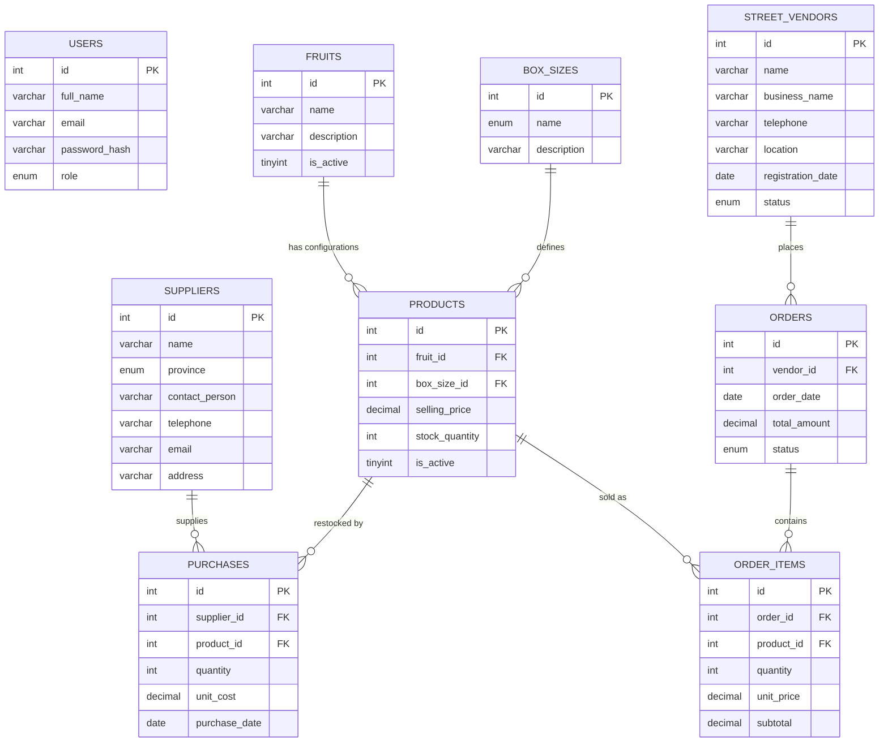

# Batloung Fruits \u2014 Entity Relationship Diagram

## Relationships

- **Supplier \u2192 Purchases (Stock)** : one supplier provides many stock purchases.
- **Fruit \u2192 Products** : one fruit has many Fruit+Box product configurations.
- **Box Size \u2192 Products** : one box size applies to many products.
- **Street Vendor \u2192 Orders** : one vendor places many orders.
- **Orders \u2192 Order Items** : one order contains many order items.
- **Products \u2192 Order Items** : one product appears in many order items.
