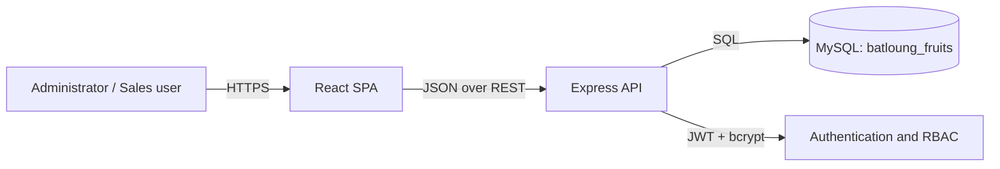

# Batloung Fruits Distribution Management System — Technical Document

## 1. Project Overview

Batloung Fruits is a small fruit distribution business that supplies street vendors in Maseru, Lesotho. This system replaces the manual, paper-based ordering process with a web application for:

- Managing the fruit catalogue (Apples, Bananas, Oranges, Mangoes, Grapes)
- Managing the three standard box sizes (Small, Medium, Large)
- Managing suppliers across the nine South African provinces
- Managing street vendors
- Recording incoming stock purchases
- Creating and tracking vendor orders through six statuses
- Producing sales, stock and purchasing reports
- Enforcing role-based access for Administrators and Sales staff

The system is a three-tier web application:

- **Frontend:** React single-page application
- **Backend:** Node.js and Express REST API
- **Database:** MySQL relational database

## 2. Architecture



Request flow:

1. The user signs in through the React login page.
2. The API validates the password with bcrypt and returns a signed JWT.
3. The frontend stores the session and sends `Authorization: Bearer <token>` on every request.
4. Express verifies the token, checks the user role where required, executes the SQL query, and returns JSON.
5. React renders the result, including validation and error messages returned by the API.

## 3. Technology Stack

| Layer | Technology | Purpose |
|---|---|---|
| Frontend | React 18, Vite | Component-based user interface and build tooling |
| Routing | React Router | Protected and role-protected application routes |
| Charts | Recharts | Dashboard and report visualisations |
| HTTP client | Axios | API communication |
| Backend | Node.js, Express | REST API and business logic |
| Authentication | JWT, bcryptjs | Stateless authentication and password hashing |
| Security | Helmet, express-rate-limit, CORS | HTTP hardening and login throttling |
| Database | MySQL 8, mysql2 | Relational storage and parameterised queries |
| Tooling | npm, ESLint, Vite build | Dependency management, linting and production build |

## 4. Directory Structure

```
batloung-fruits-restyled/
├── backend/
│   ├── config/db.js              MySQL connection pool
│   ├── middleware/auth.js        JWT verification and role authorization
│   ├── routes/                   API route modules
│   │   ├── auth.js               Login and current user
│   │   ├── fruits.js             Fruit catalogue
│   │   ├── boxsizes.js           Box size management
│   │   ├── suppliers.js          Supplier management
│   │   ├── products.js           Fruit + box size products and pricing
│   │   ├── vendors.js            Street vendors
│   │   ├── stock.js              Stock and purchase records
│   │   ├── orders.js             Orders, items and status workflow
│   │   └── reports.js            Reporting queries
│   ├── seed.js                   Seeds password hashes and demo data
│   ├── tests/api-integration.js  Live API integration test
│   ├── server.js                 Express application entry point
│   └── package.json
├── database/
│   ├── schema.sql                Database schema, keys and constraints
│   ├── seed.sql                  Demo data for all tables
│   └── ERD.md                    Entity relationship diagram
├── docs/
│   ├── TECHNICAL_DOCUMENT.md     This document
│   ├── TEST_PLAN.md              Manual and automated test plan
│   ├── CONTRIBUTION_MATRIX.md    Group contribution template
│   ├── DEMO_SCRIPT.md            Presentation walkthrough
│   └── screenshots/              UI screenshot checklist
├── frontend/
│   ├── public/images/            Fruit, brand and banner imagery
│   ├── src/
│   │   ├── api/client.js         Axios instance and helpers
│   │   ├── components/           Layout, modal, page header, icons
│   │   ├── context/              Authentication context
│   │   ├── pages/                Feature screens
│   │   ├── styles/app.css        Design system and responsive rules
│   │   └── utils/validators.js   Client-side validation helpers
│   └── package.json
├── render.yaml                   Backend deployment blueprint
├── DEPLOYMENT.md                 Hosting guide
└── README.md                     Project overview and setup
```

## 5. Local Setup

### 5.1 Prerequisites

- Node.js 18 or newer
- MySQL 8 or MariaDB through XAMPP
- npm

### 5.2 Database

```bash
mysql -u root -p < database/schema.sql
mysql -u root -p batloung_fruits < database/seed.sql
```

The seed file creates the demo data. The `backend/seed.js` script can also be used to insert bcrypt password hashes:

```bash
cd backend
npm install
npm run seed
```

### 5.3 Backend

Create `backend/.env`:

```env
PORT=5000
DB_HOST=127.0.0.1
DB_PORT=3306
DB_USER=root
DB_PASSWORD=your_mysql_password
DB_NAME=batloung_fruits
JWT_SECRET=replace_with_a_long_random_secret
JWT_EXPIRES_IN=8h
CLIENT_ORIGIN=http://localhost:5173
```

Start the API:

```bash
cd backend
npm start
```

Health check:

```bash
curl http://localhost:5000/api/health
```

Expected result:

```json
{"status":"ok","service":"Batloung Fruits API"}
```

### 5.4 Frontend

Create `frontend/.env` if the API is not on the default path:

```env
VITE_API_URL=http://localhost:5000/api
```

Start the development server:

```bash
cd frontend
npm install
npm run dev
```

Default development URL: `http://localhost:5173`

### 5.5 Demo Accounts

| Role | Email | Password |
|---|---|---|
| Administrator | admin@batloung.co.ls | admin123 |
| Sales | sales@batloung.co.ls | sales123 |

The passwords are stored as bcrypt hashes after running `npm run seed`.

## 6. Database Design

The complete entity relationship diagram is in `database/ERD.md`.

### 6.1 Entities and Relationships

| Entity | Relationship |
|---|---|
| users | One user has one role: Administrator or Sales |
| fruits | One fruit has many products |
| box_sizes | One box size has many products |
| products | Each product is one fruit plus one box size, with its own price and stock |
| suppliers | One supplier has many purchases |
| purchases | Each purchase references one supplier and one product |
| street_vendors | One vendor has many orders |
| orders | Each order references one vendor and has many order items |
| order_items | Each item references one order and one product |

### 6.2 Data Dictionary

#### users

| Column | Type | Constraints | Description |
|---|---|---|---|
| id | INT | PK, auto increment | User identifier |
| full_name | VARCHAR(120) | NOT NULL | Full name |
| email | VARCHAR(160) | NOT NULL, UNIQUE | Login email |
| password_hash | VARCHAR(255) | NOT NULL | bcrypt password hash |
| role | ENUM | NOT NULL | Administrator or Sales |
| created_at | TIMESTAMP | DEFAULT CURRENT_TIMESTAMP | Creation time |

#### fruits

| Column | Type | Constraints | Description |
|---|---|---|---|
| id | INT | PK, auto increment | Fruit identifier |
| name | VARCHAR(80) | NOT NULL, UNIQUE | Fruit name |
| description | VARCHAR(255) | NULL | Short description |
| is_active | TINYINT(1) | NOT NULL, DEFAULT 1 | Available for sale |

#### box_sizes

| Column | Type | Constraints | Description |
|---|---|---|---|
| id | INT | PK, auto increment | Box size identifier |
| name | ENUM | NOT NULL, UNIQUE | Small, Medium or Large |
| description | VARCHAR(255) | NULL | Business description |

#### products

| Column | Type | Constraints | Description |
|---|---|---|---|
| id | INT | PK, auto increment | Product identifier |
| fruit_id | INT | FK to fruits, NOT NULL | Fruit sold |
| box_size_id | INT | FK to box_sizes, NOT NULL | Box size sold |
| selling_price | DECIMAL(10,2) | NOT NULL, CHECK > 0 | Price per box in Maloti |
| stock_quantity | INT | NOT NULL, DEFAULT 0, CHECK >= 0 | Available boxes |
| is_active | TINYINT(1) | NOT NULL, DEFAULT 1 | Available for ordering |
| created_at | TIMESTAMP | DEFAULT CURRENT_TIMESTAMP | Creation time |

A unique constraint on `(fruit_id, box_size_id)` prevents duplicate products.

#### suppliers

| Column | Type | Constraints | Description |
|---|---|---|---|
| id | INT | PK, auto increment | Supplier identifier |
| name | VARCHAR(150) | NOT NULL | Company name |
| province | ENUM | NOT NULL | One of the nine South African provinces |
| contact_person | VARCHAR(120) | NULL | Contact name |
| telephone | VARCHAR(40) | NULL | Contact number |
| email | VARCHAR(160) | NULL | Contact email |
| address | VARCHAR(255) | NULL | Physical address |
| created_at | TIMESTAMP | DEFAULT CURRENT_TIMESTAMP | Creation time |

#### street_vendors

| Column | Type | Constraints | Description |
|---|---|---|---|
| id | INT | PK, auto increment | Vendor identifier |
| name | VARCHAR(120) | NOT NULL | Vendor full name |
| business_name | VARCHAR(150) | NULL | Stall or business name |
| telephone | VARCHAR(40) | NULL | Contact number |
| location | VARCHAR(120) | NULL | Operating area in Maseru |
| registration_date | DATE | NOT NULL, DEFAULT current date | Registration date |
| status | ENUM | NOT NULL, DEFAULT Active | Active or Inactive |

#### purchases

| Column | Type | Constraints | Description |
|---|---|---|---|
| id | INT | PK, auto increment | Purchase identifier |
| supplier_id | INT | FK to suppliers, NOT NULL | Supplier |
| product_id | INT | FK to products, NOT NULL | Product purchased |
| quantity | INT | NOT NULL, CHECK > 0 | Boxes received |
| unit_cost | DECIMAL(10,2) | NOT NULL, DEFAULT 0, CHECK >= 0 | Cost per box |
| purchase_date | DATE | NOT NULL, DEFAULT current date | Date received |
| created_at | TIMESTAMP | DEFAULT CURRENT_TIMESTAMP | Creation time |

#### orders

| Column | Type | Constraints | Description |
|---|---|---|---|
| id | INT | PK, auto increment | Order identifier |
| vendor_id | INT | FK to street_vendors, NOT NULL | Ordering vendor |
| order_date | DATE | NOT NULL, DEFAULT current date | Order date |
| total_amount | DECIMAL(12,2) | NOT NULL, DEFAULT 0 | Calculated order total |
| status | ENUM | NOT NULL, DEFAULT Pending | Order workflow status |
| created_at | TIMESTAMP | DEFAULT CURRENT_TIMESTAMP | Creation time |

#### order_items

| Column | Type | Constraints | Description |
|---|---|---|---|
| id | INT | PK, auto increment | Item identifier |
| order_id | INT | FK to orders, NOT NULL, ON DELETE CASCADE | Parent order |
| product_id | INT | FK to products, NOT NULL | Product ordered |
| quantity | INT | NOT NULL, CHECK > 0 | Boxes ordered |
| unit_price | DECIMAL(10,2) | NOT NULL | Price captured at order time |
| subtotal | DECIMAL(12,2) | NOT NULL | quantity multiplied by unit_price |

## 7. Business Rules

1. Only five fruits are supported: Apples, Bananas, Oranges, Mangoes and Grapes.
2. Only three box sizes are supported: Small, Medium and Large.
3. Every product is a unique fruit and box-size combination with its own price and stock.
4. An order must reference a registered and active street vendor.
5. An order must contain at least one product.
6. The same product cannot appear twice in one order.
7. Order and purchase quantities must be whole numbers greater than zero.
8. An order cannot request more boxes than the available stock.
9. The order total is calculated on the server from stored product prices.
10. When an order is changed to Completed, stock is reduced by the ordered quantities.
11. Moving a Completed order back to an earlier status restores the stock.
12. A Cancelled order never reduces stock.
13. A Completed order cannot be deleted.
14. A vendor with existing orders cannot be deleted.
15. A box size used by products cannot be deleted.
16. Recording a purchase increases the product stock by the received quantity.
17. Inactive products and inactive vendors cannot be used in new orders.
18. Order statuses flow through Pending, Confirmed, Processing, Ready for Collection/Delivery, Completed, with Cancelled as an alternative outcome.

## 8. Role-Based Access Control

Frontend routes are protected with `Protected` and `AdminOnly` wrappers. Backend routes enforce the same rules.

| Capability | Administrator | Sales |
|---|---|---|
| Sign in and view dashboard | Yes | Yes |
| View products | Yes | Yes |
| View dashboard sales summaries | Yes | Yes |
| Manage fruits | Yes | No |
| Manage box sizes | Yes | No |
| Manage suppliers | Yes | No |
| View suppliers | Yes | No |
| Register, edit and view vendors | Yes | Yes |
| Delete vendors | Yes | No |
| View stock and purchases | Yes | No |
| Record incoming stock | Yes | No |
| Create orders | Yes | Yes |
| View orders and update status | Yes | Yes |
| Delete orders | Yes | No |
| View reports page | Yes | No |

## 9. REST API Reference

Base URL: `http://localhost:5000/api`

All endpoints except login require a JWT:

```
Authorization: Bearer <token>
```

### 9.1 Authentication

| Method | Endpoint | Access | Description |
|---|---|---|---|
| POST | `/auth/login` | Public | Sign in and receive a JWT |
| GET | `/auth/me` | Authenticated | Return the current user |

Login example:

```bash
curl -X POST http://localhost:5000/api/auth/login \
  -H "Content-Type: application/json" \
  -d '{"email":"admin@batloung.co.ls","password":"admin123"}'
```

Success response:

```json
{
  "token": "<jwt>",
  "user": {
    "id": 1,
    "name": "System Administrator",
    "email": "admin@batloung.co.ls",
    "role": "Administrator"
  }
}
```

Failure responses: `400` missing fields, `401` invalid credentials.

### 9.2 Fruits

| Method | Endpoint | Access | Description |
|---|---|---|---|
| GET | `/fruits?search=&active=true` | Administrator | List and search fruits |
| GET | `/fruits/:id` | Administrator | Get one fruit |
| POST | `/fruits` | Administrator | Create a fruit |
| PUT | `/fruits/:id` | Administrator | Update a fruit |
| DELETE | `/fruits/:id` | Administrator | Delete a fruit |

Create example:

```bash
curl -X POST http://localhost:5000/api/fruits \
  -H "Authorization: Bearer $TOKEN" \
  -H "Content-Type: application/json" \
  -d '{"name":"Mango","description":"Sweet seasonal mango","is_active":1}'
```

Responses: `201` created, `400` invalid name, `409` duplicate name.

### 9.3 Box Sizes

| Method | Endpoint | Access | Description |
|---|---|---|---|
| GET | `/boxsizes` | Authenticated | List box sizes with product counts |
| POST | `/boxsizes` | Administrator | Create Small, Medium or Large |
| PUT | `/boxsizes/:id` | Administrator | Update a box size or description |
| DELETE | `/boxsizes/:id` | Administrator | Delete an unused box size |

Delete is blocked with `409` while products reference the box size.

### 9.4 Suppliers

| Method | Endpoint | Access | Description |
|---|---|---|---|
| GET | `/suppliers?search=&province=` | Administrator | List and filter suppliers |
| GET | `/suppliers/:id` | Administrator | Get one supplier |
| POST | `/suppliers` | Administrator | Create a supplier |
| PUT | `/suppliers/:id` | Administrator | Update a supplier |
| DELETE | `/suppliers/:id` | Administrator | Delete a supplier |

Create example:

```bash
curl -X POST http://localhost:5000/api/suppliers \
  -H "Authorization: Bearer $TOKEN" \
  -H "Content-Type: application/json" \
  -d '{"name":"Cape Farms","province":"Western Cape","contact_person":"Naledi Mokoena","telephone":"+27 21 555 0100","email":"sales@capefarms.co.za","address":"Paarl, Western Cape"}'
```

### 9.5 Products

| Method | Endpoint | Access | Description |
|---|---|---|---|
| GET | `/products?search=&box_size_id=` | Authenticated | List products and stock |
| GET | `/products/:id` | Authenticated | Get one product |
| POST | `/products` | Administrator | Create a fruit and box-size product |
| PUT | `/products/:id` | Administrator | Update price, stock or status |
| DELETE | `/products/:id` | Administrator | Delete a product |

Create example:

```bash
curl -X POST http://localhost:5000/api/products \
  -H "Authorization: Bearer $TOKEN" \
  -H "Content-Type: application/json" \
  -d '{"fruit_id":1,"box_size_id":2,"selling_price":85.00,"stock_quantity":50,"is_active":1}'
```

Validation: price must be greater than zero, stock must be a whole number zero or greater, and the fruit plus box combination must be unique.

### 9.6 Vendors

| Method | Endpoint | Access | Description |
|---|---|---|---|
| GET | `/vendors?search=&status=` | Authenticated | List and filter vendors |
| GET | `/vendors/:id` | Authenticated | Get one vendor |
| POST | `/vendors` | Authenticated | Register a vendor |
| PUT | `/vendors/:id` | Authenticated | Update a vendor |
| DELETE | `/vendors/:id` | Administrator | Delete a vendor with no orders |

Create example:

```bash
curl -X POST http://localhost:5000/api/vendors \
  -H "Authorization: Bearer $TOKEN" \
  -H "Content-Type: application/json" \
  -d '{"name":"Thabo Mokhele","business_name":"Thabo Fresh Market","telephone":"+266 5800 1234","location":"Maseru CBD","status":"Active"}'
```

### 9.7 Stock and Purchases

| Method | Endpoint | Access | Description |
|---|---|---|---|
| GET | `/stock` | Administrator | Current stock per product |
| GET | `/stock/purchases` | Administrator | Purchase history |
| POST | `/stock` | Administrator | Record incoming stock |
| PUT | `/stock/:productId` | Administrator | Set a product stock quantity |

Record stock example:

```bash
curl -X POST http://localhost:5000/api/stock \
  -H "Authorization: Bearer $TOKEN" \
  -H "Content-Type: application/json" \
  -d '{"supplier_id":4,"product_id":7,"quantity":40,"unit_cost":42.50,"purchase_date":"2026-11-12"}'
```

The server inserts the purchase and increases product stock in one transaction.

### 9.8 Orders

| Method | Endpoint | Access | Description |
|---|---|---|---|
| GET | `/orders?status=` | Authenticated | List orders with optional status filter |
| GET | `/orders/:id` | Authenticated | Order with items and vendor details |
| POST | `/orders` | Authenticated | Create an order |
| PUT | `/orders/:id/status` | Authenticated | Update order status |
| PUT | `/orders/:id` | Authenticated | Alias for status update |
| DELETE | `/orders/:id` | Administrator | Delete a non-completed order |

Create example:

```bash
curl -X POST http://localhost:5000/api/orders \
  -H "Authorization: Bearer $TOKEN" \
  -H "Content-Type: application/json" \
  -d '{"vendor_id":3,"order_date":"2026-11-12","items":[{"product_id":1,"quantity":2},{"product_id":5,"quantity":1}]}'
```

Success response:

```json
{"id":21,"total_amount":175.00}
```

Status update example:

```bash
curl -X PUT http://localhost:5000/api/orders/21/status \
  -H "Authorization: Bearer $TOKEN" \
  -H "Content-Type: application/json" \
  -d '{"status":"Completed"}'
```

Order validation responses:

- `400` missing vendor, invalid date, empty items, inactive vendor, inactive product, duplicate product, non-integer quantity, or insufficient stock
- `404` vendor or product not found
- `403` Sales user attempting to delete

### 9.9 Reports

| Method | Endpoint | Access | Description |
|---|---|---|---|
| GET | `/reports/dashboard` | Authenticated | Dashboard summary cards |
| GET | `/reports/sales-by-fruit` | Authenticated | Completed sales grouped by fruit |
| GET | `/reports/sales-by-date` | Authenticated | Completed sales grouped by date |
| GET | `/reports/sales-by-box` | Administrator | Completed sales grouped by box size |
| GET | `/reports/sales-by-vendor` | Administrator | Completed sales grouped by vendor |
| GET | `/reports/purchases-by-province` | Administrator | Purchases grouped by province |
| GET | `/reports/available-stock` | Administrator | Current stock report |

### 9.10 Health Check

| Method | Endpoint | Access | Description |
|---|---|---|---|
| GET | `/health` | Public | Service status |

## 10. Validation Summary

Server-side validation is authoritative. Client-side validation mirrors it for a faster user experience.

| Area | Rules |
|---|---|
| Email | Must match a standard email pattern |
| Telephone | Digits, spaces, brackets, plus and hyphen only |
| Names | Required and within database column length |
| Province | Must be one of the nine South African provinces |
| Price | Greater than zero |
| Stock | Whole number zero or greater |
| Quantity | Whole number greater than zero |
| Dates | `YYYY-MM-DD` |
| Box size | Small, Medium or Large only |
| Order items | At least one, no duplicates, within available stock |

## 11. Security

- Passwords are hashed with bcrypt; plain passwords are never stored.
- JWTs are signed with `JWT_SECRET`; the API refuses to start login without it.
- Every protected route verifies the token.
- Write operations are restricted by role.
- SQL uses parameterised queries to prevent SQL injection.
- Helmet sets secure HTTP headers.
- Login is rate limited to reduce brute-force attempts.
- CORS is restricted to configured origins.
- JSON request bodies are limited to 100 KB.
- Database errors are mapped to safe 400 and 409 responses.
- `.env` files are excluded from version control.

## 12. Google Maps Integration

Vendors and suppliers are linked to Google Maps:

- Each vendor location opens a map preview for the operating area in Maseru, Lesotho.
- Each supplier opens a map preview for the supplier address and South African province.
- Every preview includes an **Open in Google Maps** button.
- The map links use the standard Google Maps search URL and an embedded map URL.
- No Google Maps API key is required, which keeps deployment simple.
- The map helpers live in `frontend/src/components/GoogleMap.jsx`.

Map queries are built from existing data:

```
Vendor:   location, Maseru, Lesotho
Supplier: address, province, South Africa
```

## 13. Reports

The reporting module provides:

1. Dashboard cards: fruit count, supplier count, active vendors, available stock, order count, pending orders, completed orders and completed sales value.
2. Sales by fruit.
3. Sales by box size.
4. Sales by vendor.
5. Purchases by province.
6. Available stock.
7. Sales by date.

Only Completed orders contribute to sales values. This keeps revenue reporting consistent with stock reduction.

## 14. Testing

The automated API integration test and manual test cases are documented in `docs/TEST_PLAN.md`. On 12 November 2026, 55 automated checks passed against the live local database, covering authentication, RBAC, CRUD, filtering, reports, validation and stock business rules.

Frontend production build verification:

```bash
cd frontend
npm run build
```

Backend syntax verification:

```bash
cd backend
node --check server.js
node --check routes/orders.js
node --check routes/boxsizes.js
```

## 15. Troubleshooting

| Problem | Cause | Solution |
|---|---|---|
| `Table 'batloung_fruits.provinces' doesn't exist` | Old supplier query joined a non-existent table | Use the current schema where province is stored on suppliers |
| Login returns 500 | `JWT_SECRET` missing | Add `JWT_SECRET` to `backend/.env` |
| `ECONNREFUSED` on API start | MySQL is not running | Start MySQL or XAMPP |
| Frontend shows empty data | API URL or CORS mismatch | Set `VITE_API_URL` and `CLIENT_ORIGIN` correctly |
| Port 5000 already in use | Another server is running | Stop the other process or change `PORT` |
| Passwords do not work after import | Seed SQL holds placeholder hashes | Run `npm run seed` in `backend` |

## 16. Limitations and Future Improvements

- Payments are out of scope; orders are settled outside the system.
- Delivery routing and driver tracking are out of scope.
- The system stores one warehouse; multi-branch stock is a future enhancement.
- Email and SMS notifications are not yet integrated.
- Audit trails for status changes could be added.
- Automated UI tests with Playwright or Cypress would strengthen regression testing.
